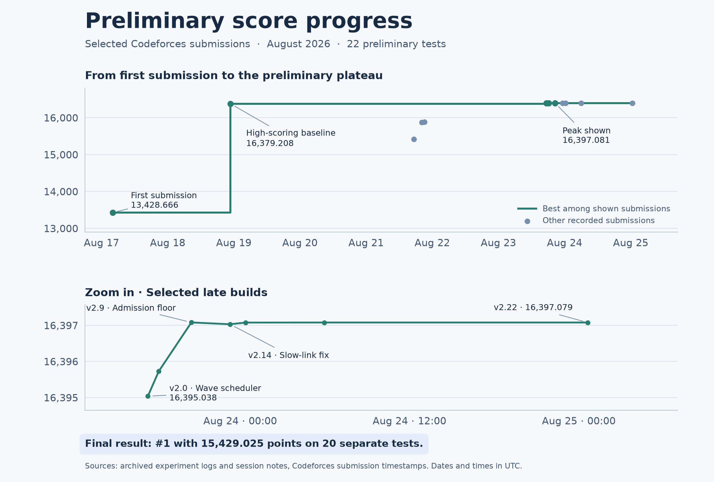

# Huawei ICPC autoresearch

This repository contains the C++ scheduler and local evaluation harness from
our work on [Edge–Cloud Collaborative Scheduling](https://codeforces.com/contest/2251/problem/A)
at the ICPC 2026 Online Challenge 1 powered by Huawei.

`sol/main.cpp` is an archived development snapshot from the original
repository at commit `a0cc953`. The exact source of the winning submission
has yet to be verified against this snapshot.

## Contest progress



The chart tracks selected submissions on the 22 preliminary tests. The final
submission placed first with 15,429.025 points on a separate set of 20 tests.

## Run locally

Requirements are a POSIX environment, Make, a C++17 compiler, and Python 3.

```sh
make check
make suite SEED=12345 PER=1
make bench
```

To compare two solver executables on a shared fresh suite:

```sh
python3 bench/compare.py --fresh --per-family 3 \
  --sol baseline=./sol/main --sol candidate=/path/to/candidate
```

Compare scores on the same suite. Use a new seed to confirm a result before
adopting it.

- [Autoresearch workflow](ORCHESTRATOR_INSTRUCTIONS.md)
- [Generator and scoring notes](docs/HARNESS.md)
- [Selected experiments](experiments/LOG.md)
